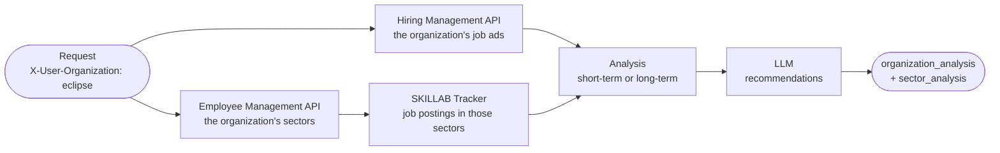
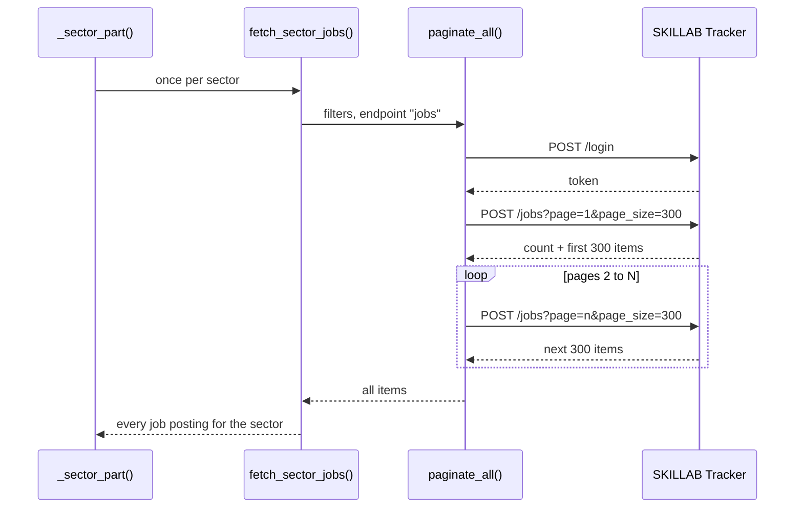

# Organization Needs

**Which skills and roles will your organization need next, and which ones are fading out?**


Organization Needs is a [SKILLAB](https://skillab-project.eu/) microservice that reads job postings and tells an organization which skills and occupations are growing, which are about to emerge, and what HR should do about it. It implements SKILLAB user stories **#23** (skills) and **#24** (occupations).

You give it an organization name. It gives you back:

- 📈 **A short-term outlook (3 years):** demand history, a forecast with confidence intervals, growth metrics and a *high / medium / low* potential tier.
- 🔭 **A long-term outlook (5 years):** an emergence score, a category from *speculative* to *breakthrough*, and an estimate of when it goes mainstream.
- 💡 **Recommendations:** three concrete actions per skill or occupation, written by an LLM and grounded in the numbers.

Every answer comes from two angles: the **organization's own job ads**, and the **wider market** in the organization's sectors.

---

## Contents

- [How it works](#how-it-works)
- [Endpoints](#endpoints)
- [Quick start](#quick-start)
- [Calling the API](#calling-the-api)
- [What you get back](#what-you-get-back)
- [Under the hood](#under-the-hood)
- [Fetching jobs from the SKILLAB Tracker](#fetching-jobs-from-the-skillab-tracker)
- [Configuration](#configuration)
- [Running the tests](#running-the-tests)
- [Project layout](#project-layout)
- [Deployment](#deployment)
- [About SKILLAB](#about-skillab)

---

## How it works



1. **Organization view.** The service pulls every job ad the organization has published in Hiring Management, along with the skills attached to each ad.
2. **Sector view.** It looks up the organization's sectors in Employee Management, then fetches the last 3 years of job postings for each sector from the SKILLAB Tracker ([details below](#fetching-jobs-from-the-skillab-tracker)).
3. **Analysis.** Both datasets go through the same pipeline (short-term forecasting or long-term emergence scoring).
4. **Recommendations.** Each skill or occupation gets three tailored recommendations from an LLM.

Comparing the two views is the interesting part: it shows where the organization's hiring is ahead of or behind its market.

---

## Endpoints

| Endpoint | Question it answers | Horizon | User story |
|---|---|---|---|
| `GET /shorttermanalysis/skills` | Which skills are in demand, and where is demand heading? | 3 years | US #23 |
| `GET /shorttermanalysis/occupations` | Which roles are in demand, and where is demand heading? | 3 years | US #24 |
| `GET /longtermanalysis/skills` | Which skills are about to break through? | 5 years | US #23 |
| `GET /longtermanalysis/occupations` | Which roles are emerging? | 5 years | US #24 |

All four take the same inputs:

| Name | Where | Default | What it does |
|---|---|---|---|
| `X-User-Organization` | header | *required* | Organization name as stored in Employee Management, e.g. `eclipse` |
| `top_n` | query | `50` | How many skills or occupations to analyze (1 to 200) |
| `rerun` | query | `false` | Discard the stored result and compute it again |

Once the service is running, interactive docs are at **`/docs`**.

---

## Quick start

### 1. Create a `.env` file

```dotenv
# SKILLAB Tracker (sector job postings)
TRACKER_API=https://skillab-tracker.csd.auth.gr/api
TRACKER_USERNAME=your-username
TRACKER_PASSWORD=your-password

# LLM used for recommendations (OpenAI-compatible chat API)
LLM_API_URL=https://your-llm-host
LLM_API_TOKEN=your-token
```

The Hiring Management and Employee Management APIs default to the public SKILLAB portal, so you only need to set them if you run your own. See [Configuration](#configuration) for every option.

### 2. Run it

**With Docker**

```bash
docker build -t organization-needs .
docker run --rm -p 8000:8000 --env-file .env organization-needs
```

**Or locally** (Python 3.11, run from the repo root so the ESCO mapping file is found)

```bash
python -m venv .venv && source .venv/bin/activate
pip install -r requirements.txt
uvicorn service:app --reload
```

### 3. Try it

Open [http://localhost:8000/docs](http://localhost:8000/docs), or:

```bash
curl -i -H "X-User-Organization: eclipse" \
  "http://localhost:8000/shorttermanalysis/skills?top_n=20"
```

---

## Calling the API

An analysis pages through thousands of postings and calls an LLM for every item, so it can take several minutes. That is why the endpoints are **asynchronous**: you call the same URL again until the result is ready.

| You get | HTTP | Meaning | Next step |
|---|---|---|---|
| `{"status": "started"}` | 202 | The analysis is now running in the background | Call again later |
| `{"status": "in_progress"}` | 202 | Still running | Call again later |
| The full result | 200 | Done. Stored, so later calls return instantly | Use it |
| `{"status": "failed"}` | 200 | Something broke. `result` holds partial output when there is any | Call again to retry |

A few things worth knowing:

- **Results are stored per endpoint + organization + `top_n`.** Asking for `top_n=20` and `top_n=50` runs two separate analyses.
- **A failure is reported once.** The next call starts a fresh attempt.
- **`?rerun=true` refreshes a finished result.** It answers `started`, then you poll *without* `rerun`. If the analysis is already running it just says `in_progress`, so you can never start duplicates.
- **Restarts are handled.** If the service restarts in the middle of an analysis, the next call notices and starts it again.

A minimal polling client:

```python
import time
import requests

URL = "http://localhost:8000/longtermanalysis/skills"
HEADERS = {"X-User-Organization": "eclipse"}

while True:
    r = requests.get(URL, headers=HEADERS, params={"top_n": 20})
    body = r.json()
    if r.status_code == 202:          # started or in_progress
        time.sleep(15)
        continue
    if body.get("status") == "failed":
        raise RuntimeError(body["message"])
    break

for skill in body["organization_analysis"].get("skills", []):
    print(f'{skill["label"]:<40} {skill["dominant_category"]:<13} EQ {skill["emergence_quotient"]}')
```

---

## What you get back

Every endpoint returns the same outer shape. The occupation endpoints use an `occupations` list where the skill endpoints use `skills`.

```jsonc
{
  "metadata": { "endpoint": "/shorttermanalysis/skills", "organization": "eclipse", "analysis_date": "..." },
  "organization_profile": { "id": "...", "name": "eclipse", "sectors": ["Computer programming activities"] },

  "organization_analysis": {
    "status": "ok",
    "data_source": "Hiring Management API (jobAds + interview-skills)",
    "jobs_retrieved": 42,
    "jobs_without_publish_date": 0,
    "metadata": { ... },
    "skills": [ ... ],            // one entry per skill, best first
    "sector_summary": { ... }     // counts per tier and the top picks
  },

  "sector_analysis": {
    "status": "ok",
    "sectors": ["Computer programming activities"],
    "results_by_sector": {
      "Computer programming activities": {
        "status": "ok",
        "jobs_retrieved": 5310,
        "skills": [ ... ],
        "sector_summary": { ... }
      }
    }
  }
}
```

Each part has its own `status` (`ok`, `no_data` or `error`) and a `message` when something is missing, so one empty source never hides the other.

<details>
<summary><b>A short-term entry</b> (click to expand)</summary>

```jsonc
{
  "uri": "http://data.europa.eu/esco/skill/ccd0a1d9-afda-43d9-b901-96344886e14d",
  "label": "Python (computer programming)",
  "time_series": {
    "historical": [ { "quarter": "2024-Q1", "count": 12 }, ... ],        // last 12 quarters
    "forecast":   [ { "quarter": "2027-Q1", "value": 31.4,
                      "ci_lower_80": 26.0, "ci_upper_80": 36.8,
                      "ci_lower_95": 23.1, "ci_upper_95": 39.7 }, ... ],  // next 12 quarters
    "forecast_method": "holt_winters"
  },
  "metrics": {
    "historical_cagr_pct": 18.2,
    "forecast_cagr_pct": 11.5,
    "demand_velocity_pct": 9.4,
    "market_penetration_rate_pct": 6.1,
    "demand_volatility": 0.42,
    "relative_growth_index": 1.35,
    "emergence_index": 0.61,
    "composite_potential_score": 0.71
  },
  "potential_tier": "high",
  "recommendations": {
    "talent_acquisition": "...",
    "training_and_development": "...",
    "compensation_and_retention": "..."
  }
}
```
</details>

<details>
<summary><b>A long-term entry</b> (click to expand)</summary>

```jsonc
{
  "uri": "http://data.europa.eu/esco/skill/3a2d5b45-56e4-4f5a-a55a-4a4a65afdc43",
  "label": "machine learning",
  "emergence_quotient": 78,
  "theta": 0.7812,
  "confidence": 0.84,
  "time_to_emergence": { "point_estimate_years": 1.79, "ci_lower_years": 1.55, "ci_upper_years": 2.03 },
  "dominant_category": "emerging",
  "fuzzy_memberships": { "speculative": 0.0, "niche": 0.0, "emerging": 0.8073, "breakthrough": 0.3433 },
  "irt_signals": {
    "posting_density":   { "value": 0.62, "description": "Skill frequency across job postings" },
    "recency_intensity": { "value": 0.71, "description": "Share of postings in last 12 months vs all" },
    ...
  },
  "total_job_mentions": 418,
  "recommendations": {
    "strategic_workforce_planning": "...",
    "partnerships_and_pipeline": "...",
    "regulatory_and_compliance": "..."
  }
}
```

Long-term occupation entries look the same, with `n_associated_skills` in place of `total_job_mentions`.
</details>

---

## Under the hood

### Short-term analysis: "where is demand heading?"

1. **Count** how many postings mention each skill or occupation in each of the last 12 quarters.
2. **Forecast** the next 12 quarters with Holt-Winters exponential smoothing (damped trend, plus seasonality once there are 12 quarters of data). Short or empty series fall back to a linear trend. Every forecast point comes with 80% and 95% intervals.
3. **Measure** the series:

   | Metric | In plain words |
   |---|---|
   | Historical CAGR | Yearly growth over the past 3 years |
   | Forecast CAGR | Expected yearly growth over the next 3 years |
   | Demand velocity | Recent momentum: this quarter compared with two quarters ago |
   | Market penetration rate | How common it is, as a share of all postings |
   | Relative growth index | Growth compared with the average of everything analyzed. Above 1.2 is an outperformer, below 0.8 is lagging |
   | Emergence index | Last 4 quarters compared with the 3-year average, on a 0 to 1 scale |
   | Demand volatility | How jumpy the growth is (coefficient of variation) |

4. **Score** everything with a **Composite Potential Score** between 0 and 1. Each input is min-max normalized across the analyzed items, then weighted:

   | Forecast CAGR | Historical CAGR | Relative growth | Emergence index | Stability |
   |:-:|:-:|:-:|:-:|:-:|
   | 30% | 20% | 20% | 18% | 12% |

5. **Tier** it: `≥ 0.65` is **high**, `≥ 0.35` is **medium**, anything lower is **low**.

### Long-term analysis: the EMERGE framework

EMERGE treats every skill like a candidate taking a test, where each question is a signal from the job market.

1. **Collect up to six signals**, each scaled from 0 to 1:

   | Signal | What it captures |
   |---|---|
   | `posting_density` | How many postings mention the skill |
   | `recency_intensity` | Share of its postings from the last 12 months |
   | `yoy_growth_rate` | This year's postings compared with last year's |
   | `occupation_breadth` | How many different occupations ask for it |
   | `geo_spread` | How many countries it appears in *(sector data only)* |
   | `cross_sector_adoption` | How many NACE sectors it appears in *(sector data only)* |

   The organization's own job ads carry no location or sector, so those two signals are left out of that analysis instead of counting as zero.

2. **Estimate maturity (θ)** with a two-parameter Item Response Theory model, by maximum likelihood. Fisher information gives a confidence value for the estimate.
3. **Categorize** θ with trapezoidal fuzzy sets. The category with the highest membership wins:

   | Category | What it means | Suggested stance |
   |---|---|---|
   | 🌱 **speculative** | Weak signals everywhere | Keep an eye on it, don't invest yet |
   | 🔍 **niche** | Some signal, still narrow | Review fit before committing budget |
   | 🚀 **emerging** | Several signals agree | Pilot training, start building a pipeline |
   | 💥 **breakthrough** | Going mainstream soon | Act within 6 to 12 months |

4. **Project time to emergence** as `5 × (1 − θ^1.8)` years (between 0.2 and 5), with an interval that widens as confidence drops.
5. **Report** the Emergence Quotient, which is simply θ × 100.

**Occupations** are scored through their skills: the service first scores the top 500 skills, links each occupation to the skills that appear alongside it in postings, and takes a θ-weighted average.

### Recommendations

For every item, the service sends the metrics plus a set of interpretation rules to an OpenAI-compatible chat endpoint (`mistral:latest` by default, temperature 0.1, fixed seed) and asks for JSON. The prompt requires each recommendation to cite actual numbers, name the skill or occupation, and match the urgency of its tier or category.

| Analysis | The three recommendations |
|---|---|
| Short-term | talent acquisition, training and development, compensation and retention |
| Long-term | strategic workforce planning, partnerships and pipeline, regulatory and compliance |

If the LLM fails three times in a row, the service falls back to built-in recommendations for that tier or category, so an analysis always completes.

---

## Fetching jobs from the SKILLAB Tracker

The Tracker feeds the **sector view** only. The organization view gets its job ads from Hiring Management instead.

### Where it happens

All Tracker code lives in `service.py`, in two places: **Section 1 (Shared infrastructure)** holds the generic login and pagination helpers, and **Section 4.3 (Sector data: SKILLAB Tracker)** holds the jobs query.

| Function | Section | What it does |
|---|---|---|
| `get_token()` | 1 | Logs in with `TRACKER_USERNAME` / `TRACKER_PASSWORD` and returns a bearer token |
| `api_extract(request_body, page, endpoint, token)` | 1 | Fetches **one page** (300 items) from any Tracker endpoint |
| `paginate_all(request_body, endpoint)` | 1 | Logs in once, reads the total `count` from page 1, then fetches the remaining pages |
| `fetch_sector_jobs(sector)` | 4.3 | Builds the filters for one sector and calls `paginate_all(..., endpoint="jobs")` |
| `_default_dates(years_back)` | 5 | Turns `TRACKER_YEARS_BACK` into a `(start, end)` date range ending today |
| `_sector_part(organization, profile, analyze)` | 5 | Loops over the organization's sectors, calls `fetch_sector_jobs` for each, and runs the analysis on the result |

### The call chain

```
GET /shorttermanalysis/skills                  (or any of the four endpoints)
└─ _run_combined()                             starts the background job
   └─ _run_analysis_job()
      └─ _compute_combined()
         ├─ fetch_org_profile()                Employee Management: get the sectors
         └─ _sector_part()                     for each sector:
            └─ fetch_sector_jobs(sector)
               └─ paginate_all(body, "jobs")
                  ├─ get_token()               POST {TRACKER_API}/login
                  └─ api_extract(...)          POST {TRACKER_API}/jobs?page=N&page_size=300
```



### What the requests look like

**1. Login.** A JSON body with the credentials. The response body is the token as a quoted string, and the service strips the quotes.

```http
POST {TRACKER_API}/login
Content-Type: application/json

{"username": "...", "password": "..."}
```

**2. Jobs, one page at a time.** Pagination goes in the query string. The filters go in the body as **form fields** (the code passes a dict to `requests.post(..., data=...)`, not `json=...`).

```http
POST {TRACKER_API}/jobs?page=1&page_size=300
Authorization: Bearer <token>
Content-Type: application/x-www-form-urlencoded

sectors=Computer programming activities&min_upload_date=2023-11-23&max_upload_date=2026-11-23
```

| Filter | Value |
|---|---|
| `sectors` | One sector name, exactly as stored in Employee Management (surrounding quotes are cleaned off by `_clean_sectors()`) |
| `min_upload_date` | Today minus `TRACKER_YEARS_BACK` years (default 3), as `YYYY-MM-DD` |
| `max_upload_date` | Today, as `YYYY-MM-DD` |

The first response's `count` decides how many pages to fetch: `ceil(count / 300)`. Pages after the first are requested with a 0.3 second pause between them, and the same token is reused for all of them.

**Try it by hand** (handy when a sector comes back empty):

```bash
TOKEN=$(curl -s -X POST "$TRACKER_API/login" \
  -H "Content-Type: application/json" \
  -d "{\"username\": \"$TRACKER_USERNAME\", \"password\": \"$TRACKER_PASSWORD\"}" | tr -d '"')

curl -s -X POST "$TRACKER_API/jobs?page=1&page_size=300" \
  -H "Authorization: Bearer $TOKEN" \
  --data-urlencode "sectors=Computer programming activities" \
  --data-urlencode "min_upload_date=2023-11-23" \
  --data-urlencode "max_upload_date=2026-11-23" | head -c 1000
```

### What the service reads from each job

The response is `{"count": <total>, "items": [ ... ]}`. From each item, the analyses use only these fields:

| Field | Used for |
|---|---|
| `upload_date` | Placing the posting in a quarter (short-term) and the recency and growth signals (long-term) |
| `skills` | List of ESCO skill URIs. Turned into readable labels with `mapping_of_ESCO_skills.xlsx` |
| `occupations` | List of ESCO occupation URIs |
| `country` or `location_code` | The `geo_spread` signal |
| `sectors` | The `cross_sector_adoption` signal |

### When something goes wrong

- A Tracker error inside one sector is caught by `_sector_part()`. That sector gets `"status": "error"` with the message, and the other sectors still run.
- Any error marks the whole analysis as `failed`, so the next call to the endpoint retries it from scratch.
- A sector with no postings in the date range gets `"status": "no_data"`, which is not treated as a failure.
- HTTP status codes from the Tracker are not checked. If a login fails or a request is rejected but the body is still JSON, it reads as zero jobs and shows up as `no_data` instead of `error`. When a sector says `no_data` unexpectedly, run the curl check above first.
- Unlike the portal calls, the Tracker requests have **no retries and no timeout**. A Tracker that hangs will keep that analysis `in_progress` until it answers.

---

## Configuration

| Variable | Required | Default | Purpose |
|---|:-:|---|---|
| `TRACKER_API` | ✅ | | SKILLAB Tracker base URL |
| `TRACKER_USERNAME` | ✅ | | Tracker login |
| `TRACKER_PASSWORD` | ✅ | | Tracker password |
| `LLM_API_URL` | ✅ | | LLM host. Requests go to `{LLM_API_URL}/api/chat/completions` |
| `LLM_API_TOKEN` | ✅ | | Bearer token for the LLM |
| `LLM_MODEL` | | `mistral:latest` | Model name |
| `LLM_TIMEOUT` | | `120` | Seconds per LLM request |
| `HIRING_API` | | `https://portal.skillab-project.eu/hiring-management` | Hiring Management base URL |
| `EMPLOYEE_API` | | `https://portal.skillab-project.eu/employee-management` | Employee Management base URL |
| `PORTAL_API_TOKEN` | | | Bearer token, only if the portal gateway asks for one |
| `TRACKER_YEARS_BACK` | | `3` | How many years of sector postings to fetch |
| `ROOT_PATH` | | | FastAPI root path when running behind a reverse proxy |

---

## Running the tests

```bash
pip install -r requirements.txt
pytest tests.py -v
```

The suite has 209 tests and never touches the network. The portal APIs, the Tracker, the ESCO file and the LLM are all replaced with in-memory fakes, so it runs in about 10 seconds.

---

## Project layout

```
organization-needs/
├── service.py                    # FastAPI app: data fetching, analyses, endpoints
├── tests.py                      # pytest suite (no network needed)
├── mapping_of_ESCO_skills.xlsx   # ESCO skill URI → label lookup (14,579 skills)
├── requirements.txt
├── Dockerfile
├── docker-compose.yml            # production deployment
└── jenkins/Jenkinsfile           # CI/CD pipeline
```

Finished analyses are written as JSON files to `completed_anlyses/` (created on first use).

---

## Deployment

Every push to `main` goes through the Jenkins pipeline, which:

1. Builds the image, with the Tracker and LLM credentials injected into `.env`
2. Pushes it to the SKILLAB Harbor registry and to Docker Hub
3. Deploys it with `docker compose up -d`

In production the container is published on port **8871**, joins the external `shared-net` Docker network (that is how it reaches `hiring-management-backend` and `employee-management-backend` by name), and keeps finished analyses in the `organization-needs_anlyses` volume so they survive restarts.

---

## About SKILLAB

This service is part of **SKILLAB: Monitoring the Demand and Supply of Skills in the European Labour Market**, a Horizon Europe project (Grant Agreement No. 101132663) building tools that help organizations, educators and policymakers understand skill shortages and gaps. Learn more at [skillab-project.eu](https://skillab-project.eu/).

*Funded by the European Union. Views and opinions expressed are those of the author(s) only and do not necessarily reflect those of the European Union. Neither the European Union nor the granting authority can be held responsible for them.*

## License

Released under the [Eclipse Public License 2.0](LICENSE).
